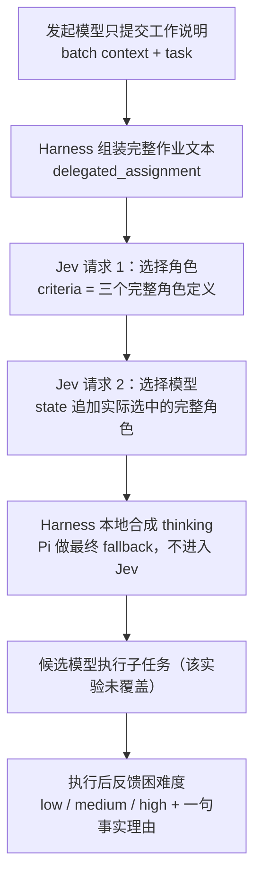

# Subagent 自动路由实验：设计记录（英文 Jev）

## 状态

本文保留早期“task → 角色 → 模型”两阶段自动路由的设计说明，以及一次 10 个案例、40 次请求的英文 Jev 分类实验原始记录。

- 用户随后完成了 28 个真实历史任务、112 次请求的补充实验，并确认效果足够。已确认的路由方案现已并入 [Subagent 公开契约](subagent-contract.md) 和 [总体范围](00-scope.md)。
- 本文作为提示词、角色定义、Preference 与早期结果的证据附件保留，不再是等待接受的独立提案；主设计约定以公开契约为准。
- 本文当时只合并实验文档；原生 Jev 路由的当前实现与离线集成验证见主契约。候选模型的实际执行质量、thinking 效果仍不属于这些分类实验的结论。
- 后续实验结论见 [历史任务补充实验报告](../experiments/jev-routing/CONCLUSIONS.md)。两个上下文变体在该批 28 个任务上的角色与模型选择均一致，用户已接受其可行性，不再以扩大测试作为采纳设计的前置条件。
- 撰写和合并本文时没有执行新的实验或 API 调用；下文早期实验的输入、结果和统计保持原样。

工作示例与附录中的英文提示词文本是实验中实际发送的原文，逐字保留；请求代码块是结构示意，中文是设计与记录说明。

## 目标与硬边界

每一条子任务的自动路由流程：



硬边界：

- 发起模型只提供工作描述。接口不接受 agent、role、model、effort、thinking、provider、preference、工具装载等选择参数；这些都不是调用方旋钮。
- 角色与模型是两个独立维度：先选角色，再选模型；不存在 `(model, role)` 组合预设，也不做组合枚举。
- 两次 Jev 请求是串行依赖：模型问题必须读取实际选中的完整角色说明，因此不能合并为一次多问题调用。
- 第二次决策的输入是原始任务加实际选中的详细角色（`state.selected_role.instructions` 为该角色定义全文），不是角色名或角色摘要。
- thinking 不进入 Jev 判定，由 Harness 本地合成、Pi 做最终 fallback，不产生第三次 Jev 请求。
- 角色的工具权限属于 Harness 内部配置，不对调用方暴露为选择项。角色说明可表达判定所需的操作与权限边界；工具注册和装载不由 Jev 生成。
- `name` 等编排信息不参与路由选择。当前公开契约已撤销 `outputSchema`／`schemaMode`，不做结构化结果返回；本文保留实验请求，不定义工具 Schema。
- 继承上下文（inherited）子代理的模型与身份如何与自动路由交互，本文不做静默结论，保留为未决问题。

## 请求形状与两阶段依赖

实际请求形状（按实验记录重绘的示意，不是可运行代码）：

```js
// 固定顶层：model（请求别名）、state（判定输入）、questions（问题集合）。

// 阶段 1：task -> role
const roleRequest = {
  model: "~typesafe/jev-latest",
  state: {
    // 完整作业文本：batch context + task，由 Harness 组装
    delegated_assignment: "# Batch context\n\n" + batchContext + "\n\n# Task\n\n" + task,

    // 仅 full_startup 变体追加；与作业文本分开，属于“原始环境输入”
    startup_context: {
      provenance: "...",              // 基线来源说明（附录 D 原文）
      system_instructions: "...",     // Pi 0.99.2 Fresh 基线系统提示
      tool_definitions: [/* read, bash, edit, write */],
      task_tool_description: "..."    // 实际安装的 task 工具说明
    }
  },
  questions: {
    role: {
      type: "choice",                 // 单选
      instructions: ROLE_INSTRUCTION, // 附录 A 第 1 条原文
      criteria: {                     // 标签 -> 完整角色定义（附录 B 原文）
        researcher: "...",
        executor: "...",
        reviewer: "..."
      }
    }
  }
};

// 阶段 2：task + 已选角色 -> model（在阶段 1 的 state 上追加 selected_role）
const modelRequest = {
  model: "~typesafe/jev-latest",
  state: {
    delegated_assignment: roleRequest.state.delegated_assignment,
    startup_context: roleRequest.state.startup_context, // 仅 full_startup 变体
    // 关键依赖：不是角色名，而是实际选中角色的完整说明
    selected_role: {
      id: roleResult.answers.role.choice,
      instructions: roleDefinitions[roleResult.answers.role.choice]
    }
  },
  questions: {
    model: {
      type: "choice",
      instructions: MODEL_INSTRUCTION, // 附录 A 第 2 条原文
      criteria: {                      // 仅模型 Preference（附录 C 原文）
        gemini: "...",
        deepseek: "..."
      }
    }
  }
};
```

字段含义：

- `model`：请求别名 `~typesafe/jev-latest`，真实服务版本由服务端解析。实验端点为 OpenRouter 的 `https://openrouter.ai/api/alpha/decisions`；40 次请求实际都由 `typesafe/jev-1.13-20260917` 服务（provider: TypeSafe）。
- `state`：判定输入。本实验用 JSON 对象：`delegated_assignment` 是完整作业文本；`startup_context` 是可选、分开放置的原始启动环境；`selected_role` 只出现在第二阶段。
- `questions`：问题名 → `{ "type": "choice", "instructions": ..., "criteria": ... }`。同一请求内的问题相互独立，所以模型问题不可能在同一次调用中看到角色答案——这正是必须两次调用的直接原因；把所有 `(model, role)` 组合列成一个选项又会退化成被用户否定的预设。
- 返回：`answers.<问题名>` 为 `{ type, choice, probabilities, confidence }`；顶层还有 `model`（实际服务版本）、`provider`、`usage`、`id`。

## 工作示例：一个真实任务的输入与结果

实际派发过的任务 `actual_jev_documentation_assignment`（发送文本中不包含任何角色/模型选择参数）。

批次背景（batch context 原文）：

```text
# Goal
Prepare a follow-up English Jev experiment with realistic long subagent instructions, detailed independent role definitions, and model-specific Preferences. Two serial choices only: task -> role; task + selected role -> model. NEVER combined presets. No harness implementation changes. User wants realistic local startup content, not toy one-sentence tasks.
# Constraints
Read-only. Skip formatters, linters, builds and all tests. Do not access credentials or make paid requests. Do not operate Firefox. Prior scout agents hit Gemini quota 429 in previous turn; if execution succeeds now do scoped work, no retry loops.
# Contract
Main authors experiment fixtures and executes requests. Return exact evidence and compact findings; no design delegation.
```

任务（task 原文）：

```text
# Target
Official Jev/TypeSafe docs or model card addressing supported languages and writing instructions/criteria/state for complex classification.
# Change
Use web_search and read official sources. Look specifically for evidence for or against weaker non-English support, long structured state guidance and criteria descriptions. User recalls weaker multilingual support; do not assume it is true or benchmark language. No live classifier calls and no local changes.
# Acceptance
Return source URLs with specific supported claims and an explicit unknown where docs do not establish multilingual capability. English-only experiment remains chosen regardless. Skip validation.
```

组装方式（`extensions/subagent.mjs:478-481` 的 `composePrompt`）：

```text
delegated_assignment = "# Batch context\n\n" + context + "\n\n# Task\n\n" + task
```

该案例在两个变体下的记录结果：

| 变体 | 阶段 1（role） | 阶段 2（model） |
|---|---|---|
| `assignment_only` | researcher，p=0.96，confidence 0.94 | gemini，p=1.00，confidence 0.99 |
| `full_startup` | researcher，p=0.93，confidence 0.90 | gemini，p=0.99（deepseek 0.01），confidence 0.99 |

说明：本轮两项真实委派尝试因 provider 配额（429）失败；随后复用它们的任务文本进行 Jev 分类，不代表已经按分类结果执行了候选模型。

## 输入组织

五类输入，以及它们为什么分开：

1. **作业文本（batch context + task）**：唯一代表“要做的事”的输入，完整进入 `delegated_assignment`，不摘要、不拆散。
2. **启动环境（startup context）**：与作业文本分开的独立字段，只在 `full_startup` 变体出现；它描述环境（系统提示、工具、task 工具说明），不携带任务授权。
3. **第一批 criteria：完整角色定义**：三个角色全文（附录 B），不压缩为标签、不用角色名代替。
4. **第二批 state：实际选中的完整角色**：`selected_role = { id, instructions }`，`instructions` 为该角色定义全文。
5. **第二批 criteria：模型 Preference**：只有两个模型族的偏好文本（附录 C），不含角色、thinking、工具或组合条件。

角色定义与 Preference 的分工：

- 角色定义写“责任 / 工作方式 / 权限边界 / 完成要求”，是“选哪个角色”的证据。本次三份定义没有配置模型名、thinking 档位或工具清单；Completion 均要求完成后以 low/medium/high 报告实际困难度并给一句事实理由。
- Preference 写“模型族之间的经验对比”，结构为 Evidence basis（本地证据、非通用 benchmark）、Observed strengths（何时优先）、Relative limitations and tradeoffs（何时反向选择）、Scope（与角色解耦）。
- tie-break 由 Preference 明确给出：以解释、阅读、发现问题、写作质量为主时倾向 Gemini；以正确改代码、修复并验证为主时倾向 DeepSeek；“编辑 Markdown 本身不算代码实现优势”；“小而机械的修改也算实现类”。
- 两套文本必须分开：角色 prompt、thinking、工具配置或 `(model, role)` 组合条件不得塞进 Preference，否则就是被否定的预设。

启动环境的实际内容与局限：

- 原始启动环境是用本地安装的 Pi 0.99.2 的 `buildSystemPrompt`（配合 `createCodingToolDefinitions`）生成的 Fresh 基线：包含来源说明、系统提示、四个工具（read / bash / edit / write）定义和实际安装的 task 工具说明。
- 它不是运行时的真实继承上下文：没有捕获的父系统提示、继承消息、项目指令或技能（provenance 原文见附录 D）。`full_startup` 变体只代表“Jev 能看到更接近真实子代理启动面的文本”，不代表真实继承会话。
- 当前仓库只注册默认 agent；本实验的三个角色是为实验撰写的，不是已批准的角色分类法。

候选模型的边界：

- Gemini / DeepSeek 是模型族候选，代表用户经验中的两类能力倾向；不是固定版本的生产模型，不是 benchmark 结论，也没有绑定角色。
- 候选模型的硬可用性与失败行为没有测试、没有定案。实验期间真实子代理执行曾遇到 provider 配额（429）；本设计不含任何静默 fallback，也不允许临时发明一个。

## Thinking 层级设计（未验证）

- 策略层使用三档：low / medium / high。它不进入 Jev 的判定目标，由 Harness 在本地合成，再交给 Pi 做最终 fallback，不追加第三次 Jev 请求。
- 合成约定：

```text
role 提供期望 thinking（该角色的配置值，不是发起模型对任务难度的预测）
model 提供 thinking 策略区间 [min, max]
Harness 将角色期望限制在模型策略区间内，产生目标档位
Pi 按物理模型能力做最终 clamp / fallback
```

- 目标策略：自动路径不超过 high；max 只保留给用户在主会话手动选择。
- 三档与合成方向已经确定，各角色和模型的具体配置值尚未确定。本次未验证不支持档位时的最终结果及自动路径上限的落实，不声称已建立硬上限保证；不在上层另写一套 Pi fallback 规则。
- 发起模型不预测难度、不选 thinking（缺执行前证据）；子代理完成后反馈实际困难度 low/medium/high 加一句事实理由，这是回顾性信息，不能反向用于为当前任务重挑模型或 thinking。
- 没有 presetFit、没有自动配置学习：不存在从历史结果自动拟合 role-model 映射或自动调参的机制。

## 已执行的英文实验

### 设置

- 10 个案例：8 个实验撰写场景 + 2 个本次会话真实派发过的任务原文（含 batch context）。期望角色/模型是事先声明的设计预期，不是独立人工标注或执行结果标注。
- 2 个输入变体都保留完整任务、角色定义和模型 Preference；`assignment_only` 不附加通用启动环境，`full_startup` 再附加原始 Fresh 启动基线文本。两者的第二阶段都会加入实际选中的角色。
- 规模：10 案例 × 2 变体 × 2 阶段 = 40 次请求，全部成功；每个案例每个变体只运行一次。
- 端点与模型：`https://openrouter.ai/api/alpha/decisions`；请求别名 `~typesafe/jev-latest`；实际服务版本 `typesafe/jev-1.13-20260917`（provider: TypeSafe）。
- 完整请求/响应记录保存在本次实验的本地工件中；本文档只嵌入必要内容，不依赖该工件路径。

### 逐案例结果

| 案例 id | 预期角色 | 预期模型 | assignment_only | full_startup |
|---|---|---|---|---|
| `trace_execution_modes` | researcher | gemini | researcher / gemini | researcher / gemini |
| `implement_contract` | executor | deepseek | executor / deepseek | executor / deepseek |
| `review_contract` | reviewer | gemini | reviewer / gemini | reviewer / gemini |
| `rewrite_user_documentation` | executor | gemini | executor / gemini | executor / gemini |
| `inspect_and_repair` | executor | deepseek | executor / deepseek | executor / deepseek |
| `narrow_mechanical_change` | executor | deepseek | executor / deepseek | executor / deepseek |
| `implementation_plan_only` | researcher | gemini | researcher / gemini | researcher / gemini |
| `documentation_review_only` | reviewer | gemini | reviewer / gemini | reviewer / gemini |
| `actual_local_startup_assignment` | researcher | gemini | researcher / gemini | researcher / gemini |
| `actual_jev_documentation_assignment` | researcher | gemini | researcher / gemini | researcher / gemini |

两个变体各自都是 10/10 角色匹配、10/10 模型匹配——这是对照事先声明的设计预期，不是准确率校准。

### 输入规模与时延

| 变体 | 角色匹配 | 模型匹配 | 单次输入 token 范围 | 输入 token 合计 | 两阶段总耗时中位数 | 两阶段最小 / 最大 |
|---|---|---|---|---|---|---|
| `assignment_only` | 10/10 | 10/10 | 1419–1623 | 30462 | 1238.5 ms | 1133 / 2258 ms |
| `full_startup` | 10/10 | 10/10 | 2878–3082 | 59642 | 1216 ms | 1172 / 1384 ms |

40 次成功响应的 `usage.cost` 合计为 0.00378437 USD（仅作为记录，不构成成本结论）。

### 概率变化示例

`actual_jev_documentation_assignment`（本文工作示例）：角色概率 researcher 0.96（confidence 0.94，`assignment_only`）→ 0.93（confidence 0.90，`full_startup`）；两次选中同一角色，模型阶段也都选 gemini（p=1.00 / 0.99，均为高置信）。这两个数字只是一次运行内的记录，不构成因果结论：附加启动上下文没有改变选择，也没有证据说明上下文越多越好（官方 jaggedness 页同样提醒无关内容会干扰判定）。

### 证据边界

- 期望标签是设计预期，不是独立人工标注或执行结果标签；两个变体各自只跑一次。
- 没有候选模型的执行证据：真实子代理执行遇到 provider 配额（429）失败，本实验只评估 Jev 分类。
- 只比较了三个角色和两个模型族；没有英文与中文指令的对照实验。
- 启动环境是生成的 Fresh 基线，不是真实继承会话（无父提示、历史、项目指令、技能）。
- 没有验证 thinking 合成的效果、难度反馈的校准，也没有端到端集成。
- 结论：两阶段英文路由的工作流可用性已得到初步证明；选择质量与端到端效果仍待验证。

## 官方来源

- [https://docs.typesafe.ai/concepts/state.md](https://docs.typesafe.ai/concepts/state.md) —— 输入形式的依据：Jev 只接受文本，state 可以是字符串、JSON 对象或文本数组；官方说明英语是主要训练语言，其他语言（含 CJK）可用但目前准确率较低。所引用页面未给出逐语言准确率数字。本次实验选择英文输入，不假定非英语输入达到同等效果。
- [https://docs.typesafe.ai/model-jaggedness/jev-1.13.md](https://docs.typesafe.ai/model-jaggedness/jev-1.13.md) —— 官方承认 jev-1.13 存在已知 jagged edges；其中 “Large state full of irrelevant detail” 说明与判定无关的内容会作为干扰项降低准确率，建议先过滤 state、只发送问题需要的字段。这支持两点：输入应尽量相关，且启动上下文并非越多越好。
- [https://openrouter.ai/docs/guides/community/jev-tutorial](https://openrouter.ai/docs/guides/community/jev-tutorial) —— 实验所用 OpenRouter decisions API 与 `~typesafe/...` 模型别名（`/api/alpha/decisions`）的用法依据。

以上是官方文档公开主张的转述；撰写本文时没有进行新的调研。

## 本轮未定案的实现事项

路由方案的可行性已被用户接受；以下条目保留实现边界或实验覆盖说明，不构成继续加测的要求，也不阻止方案并入主文档：

1. 三个实验角色是否构成合理的最终角色分类法（当前仓库只注册默认 agent）。
2. 模型族候选与实际生产模型版本的对应关系；候选不可用或配额失败时的行为（不允许静默 fallback）。
3. 启动上下文是否有净收益：本实验未见选择变化，但输入规模接近翻倍；官方提醒无关上下文会降低准确率。
4. 中文/英文指令对照未做：所引用官方页面说明非英语（含 CJK）准确率较低，但未给出逐语言数字；本次英文实验不能外推。
5. thinking 合成的具体值与越界行为未验证；事后困难度反馈与实际 thinking 档位的关系未校准。
6. 继承上下文子代理与自动路由的交互（模型/身份是否保持）未决。
7. 置信度是否用于门槛、重试或其他策略未定义；presetFit 与自动学习不在设计中。
8. 端到端集成未实现：在 subagent runtime 中真正执行两阶段路由、把结果落到子代理启动，均未验证。

## 附录 A：两条路由指令原文（实验中实际发送）

第一次请求 `questions.role.instructions`：

```text
Select the role whose responsibility and authority match the final deliverable requested in delegated_assignment. Use the complete task, including its scope, constraints, and acceptance conditions. The criteria contain the candidate role instructions. Generic startup instructions and available tools describe the environment, not permission to expand the assignment. Investigation or validation performed as part of an authorized change does not turn it into a research-only or review-only task. Select a role only; do not select a model or thinking level.
```

第二次请求 `questions.model.instructions`：

```text
Select the model best suited to complete delegated_assignment under selected_role. Use the supplied model Preferences as comparative evidence and prioritize the concrete deliverable and its quality requirements. The role is already selected and must not be changed. A model is not permanently associated with a role. Generic startup text, available tools, role labels, and prompt length must not substitute for the actual work. Do not invent missing capability or price differences, and do not predict task difficulty or select thinking.
```

## 附录 B：三个角色定义原文（实验中实际发送）

`questions.role.criteria` 的三段完整原文（未压缩）：

researcher：

```text
# Responsibility
You investigate questions whose requested outcome is understanding, evidence, diagnosis, or a comparison of options. Work may include source-code exploration, reading documentation, tracing behavior, investigating a reported failure, or developing an implementation proposal that has not been authorized for execution.

# Working method
Start from the actual question. Inspect relevant artifacts, follow dependencies when needed, and use narrow non-destructive checks to test material hypotheses. Distinguish observed facts, user-provided facts, and inference. Reconcile conflicting evidence rather than collecting snippets. Provide concrete paths, symbols, sources, or reproducible observations that support your answer.

# Authority and boundaries
This role does not modify production deliverables, repository code, configuration, or documentation. Read access and controlled diagnostic commands do not imply permission to repair what you discover. Explanatory code samples and proposed changes may appear in the answer, but are not applied. If the requested final outcome is an actual authorized change, choose the execution role instead. If the task is specifically an independent assessment of an existing artifact for defects or compliance, choose the review role instead.

# Completion
Deliver an evidence-backed answer, diagnosis, or recommendation with uncertainties and the next actionable decisions. Do not claim execution or verification you did not perform. After completion, report experienced difficulty as low, medium, or high with one factual reason; this is retrospective feedback, not a request to select a model or thinking level.
```

executor：

```text
# Responsibility
You own completion of authorized changes to a concrete deliverable. The deliverable may be executable code, configuration, technical documentation, or another repository artifact. Success means making the requested change and checking it, not only describing what someone else should do.

# Working method
Read the current implementation and relevant conventions before editing. Investigate uncertainty only as far as needed to make a correct change. Preserve existing user work, choose the smallest coherent solution, update affected callers or contracts when required, and validate the observable result using checks proportional to the change. For a repair, establish the cause and confirm the failing behavior is addressed. For documentation, verify factual claims and edit the prose itself.

# Authority and boundaries
Modification authority is limited to the assignment's scope. Do not add unrelated abstractions, redesigns, fallback paths, or cleanup. Investigation, review, and testing can be steps inside execution; their presence does not change ownership of the final deliverable. An assignment to inspect and fix confirmed defects belongs here even if no edit turns out to be necessary. A proposal-only or findings-only assignment does not.

# Completion
Deliver the authorized changes and evidence that they meet the requested acceptance conditions, or a precise evidence-backed blocker. Clearly separate completed work from recommendations. After completion, report experienced difficulty as low, medium, or high with one factual reason; do not choose a model or thinking level.
```

reviewer：

```text
# Responsibility
You independently evaluate an existing artifact against its intended behavior, requirements, correctness obligations, or stated claims. Artifacts may include code changes, configurations, designs, documentation, or completed work. Your deliverable is an assessment, not ownership of implementation.

# Working method
Understand the artifact and the claim being evaluated. Trace affected callers and relevant evidence. Identify concrete failure conditions, missing requirements, misleading statements, or material risks. Validate important suspicions with narrow non-destructive checks when useful. Rank findings by practical consequence. Treat style preferences and speculative concerns differently from demonstrated defects.

# Authority and boundaries
Do not modify the artifact or silently take over repair. Suggested fixes or replacement wording may be included in findings, but must not be applied. If the assignment authorizes and requires fixing confirmed problems before completion, it belongs to the execution role. If the primary goal is open-ended understanding or comparing unapproved approaches rather than evaluating an existing artifact, it belongs to the research role.

# Completion
Provide actionable findings with location, trigger, consequence, and evidence. If no supported finding exists, say so and state the coverage limits; finding something is not mandatory. After completion, report experienced difficulty as low, medium, or high with one factual reason; do not infer or change the execution model or thinking level.
```

## 附录 C：两个模型 Preference 原文（实验中实际发送）

`questions.model.criteria` 的两段完整原文；结构为 Evidence basis / Observed strengths / Relative limitations and tradeoffs / Scope（分工说明见“输入组织”）：

gemini：

```text
# Evidence basis
These preferences summarize this user's prior observations about the Gemini candidate relative to the DeepSeek candidate. They are local routing evidence, not universal benchmark claims.

# Observed strengths
Good at natural-language explanation, source-code reading, understanding existing behavior, and discovering problems. Prefer when successful delivery depends primarily on accurate interpretation, finding relevant issues, synthesizing evidence, or clear explanatory writing. This can include actually authoring or revising documentation, not only read-only work.

# Relative limitations and tradeoffs
The user has found DeepSeek more reliable at code implementation. When correctness of actual code changes is the central requirement, prefer that observed implementation advantage over Gemini's prose strength. Gemini's cost was described as moderate; no comparative cost or latency evidence is provided, so do not invent a price ranking.

# Scope
This model is not bound to any role. Evaluate the concrete assignment and the chosen role together; a role name alone does not determine fit.
```

deepseek：

```text
# Evidence basis
These preferences summarize this user's prior observations about the DeepSeek candidate relative to the Gemini candidate. They are local routing evidence, not universal benchmark claims.

# Observed strengths
The user has found code implementation noticeably more reliable than Gemini's. Prefer when successful delivery depends primarily on making correct code changes, preserving existing behavior, and carrying an implementation or repair through validation. A small mechanical edit can qualify; do not require the task to look difficult.

# Relative limitations and tradeoffs
Natural-language performance is weaker in this user's experience. When the main quality requirement is nuanced explanation, evidence synthesis, issue discovery, or polished prose, prefer the candidate with observed strengths in those areas. Editing a Markdown file is not by itself a code-implementation advantage. No comparative cost or latency evidence is provided.

# Scope
This model is not bound to any role. Short result explanations accompanying code changes do not erase its implementation advantage. Evaluate the actual deliverable rather than the role label or prompt length.
```

## 附录 D：固定输入原文

共享批次背景（8 个撰写案例使用的 batch context 原文；两个真实案例使用各自真实的 batch context）：

```text
Work is delegated to an independent subagent. The assignment is self-contained; do not assume access to unprovided parent conversation. Use the repository and cited files as evidence when the assignment permits it. Preserve unrelated user work. Report only actions and checks actually performed. Each assignment defines its own deliverable and authorization boundary; neighboring examples are not part of its scope.
```

启动基线（`full_startup` 变体 `state.startup_context` 的字段）：

- `provenance` 原文：

```text
Generated from the locally installed Pi 0.99.2 system-prompt builder and default coding tool definitions. This is the generic fresh-session baseline, not a captured user session or inherited chat history. Project-specific instructions and skills are omitted.
```

- `system_instructions`：Pi 0.99.2 生成的通用 Fresh 系统提示（本地生成、可复现；本文不展开全文）。
- `tool_definitions`：read / bash / edit / write 四个基础工具定义。
- `task_tool_description` 原文：

```text
Create subagents that run in the background (deferred). Validates the whole batch first and registers it atomically; each registered entry gets a stable agentId and jobId, in input order. Results are read later through agent://<agentId> and history://<agentId> (or hub jobs). Completion does not start a new parent turn, and this tool does not touch work items.
```

两个真实案例的来源说明（案例记录原文）：

```text
actual_local_startup_assignment: Exact context and task text sent to LocalStartupInputs in this session; no role or model selector included.
actual_jev_documentation_assignment: Exact context and task text sent to JevEnglishGuidance in this session; no role or model selector included.
```

