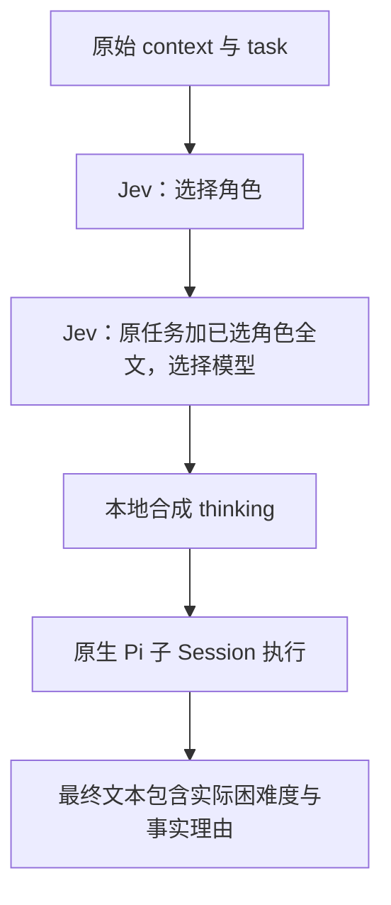

# Subagent 公开契约

## 状态与范围

本文件是当前公开行为基线。实现可以替换，但外部语义需要显式修订，不能由实现悄悄改变。

实现位于 `src/subagent-runtime.mjs`、`src/subagent-routing.mjs`、`src/subagent-storage.mjs`、`src/protocol-io.mjs` 和 `extensions/subagent.mjs`。子任务使用 Pi `createAgentSession()`：支持 Fresh／Inherited 原子批次、deferred Job、并发与派生限制、取消／`stopping`、Job Budget、消息与续跑、直接子级广播、类型化完成通知，以及原生会话持久化与恢复。

本轮决策：

- Fresh 自动路由直接使用 Pi 内置 TypeSafe／OpenRouter 的 Jev，不另造请求、鉴权或通用分类器框架。
- 结构化结果返回不做，不保留 `outputSchema`／`schemaMode` 目标。
- blocking、`waiting` 与同步等待暂缓；所有任务仍为 deferred。
- 完成通知复用 Agent 消息通道，但类型与普通消息不同；不自动启动空闲父 Agent 或 Main。
- `agent://all` 只广播到发送者的直接子 Agent，`all` 不能成为 Actor ID。
- 持久化复用 Pi 的 SessionManager JSONL 与根会话 custom entry，不另写数据库或日志引擎。
- worktree／文件系统隔离不在当前计划内。DeepSeek Search 是现成插件，由用户自行安装，本模块不增加安装或接入代码。

## 核心边界

1. Agent 是可寻址、保留上下文的会话实体；Job 是该 Agent 的一次执行。显式消息可为同一 Agent 创建新的 continuation Job。
2. Fresh 不继承父聊天历史；Inherited 只复制创建时的有效上下文，之后不自动同步，也不复制文件系统。
3. 调用方提交工作说明，角色、模型、thinking 与工具装载由 Harness 决定，不是公开旋钮。
4. Subagent 与 `work` 独立：创建、结束、失败或取消均不隐式修改工作项，也不自动编排下一步。
5. 发送者身份与消息类型由宿主绑定，正文不能冒充。协议写入本身只发送消息，不直接执行 Tool／MCP。
6. 完成事件是结果事实，不是继续执行的授权；失败、取消与重启都不自动重试工作。
7. 结果与历史可重复读取；初始 Job 的正式结果不会被续跑覆盖。

## `task`

唯一的批量创建入口：

```json
{
  "context": "这一批任务共享的显式背景。",
  "tasks": [
    { "name": "InspectParser", "task": "检查解析器的错误恢复行为并返回问题清单。" },
    { "name": "ContinueDesign", "task": "基于当前讨论继续检查契约。", "inheritContext": true }
  ]
}
```

```ts
type TaskBatch = {
  context?: string;
  tasks: {
    name?: string;
    task: string;
    inheritContext?: boolean;
  }[];
};
```

- `tasks` 不得为空，`task` 是独立任务指令，`context` 是该批次的共同背景。
- 不设置 `inheritContext: true` 就是 Fresh；同一批次可以混合 Fresh 与 Inherited。
- 不接受 `agent`、`role`、`model`、`thinking`、`effort`、`provider`、`preference`、`tools` 或结果 Schema；未知字段使整个批次校验失败，没有兼容别名。
- 先校验整个批次和拓扑准入，再原子注册；失败不留下半创建任务。注册后一个 Job 的失败或取消不影响兄弟 Job。
- 输入数组不表示依赖顺序；返回条目保持输入顺序。
- `task` 不等待路由或任务完成，返回稳定 ID 和当时状态：

```json
{
  "items": [
    {
      "name": "InspectParser",
      "agentId": "agent_7f3c21e4b9a2-01",
      "jobId": "job_7f3c21e4b9a2-01",
      "status": "running"
    }
  ]
}
```

条目没有 `delivery` 字段，也不内联完整结果。终态视图附带 `resultRef` 与 `historyRef`。Inherited 中不能移植的外部扩展工具仍通过 `warnings` 明示，不因移除工具选择参数而静默消失。

## Fresh 自动路由

配置集中在 [`config/subagent-routing.json`](../config/subagent-routing.json)。两次 Jev 请求有串行依赖，不能合并成两个独立问题：第二次必须读到第一次实际选中的完整角色定义。



### 配置与原生调用

| 项目 | 默认值 |
| --- | --- |
| 分类器 | provider `openrouter`，id `~typesafe/jev-latest` |
| TypeSafe 替代配置 | provider `typesafe`，id `jev-latest` |
| Gemini 候选 | provider `openrouter`，model `~google/gemini-pro-latest` |
| DeepSeek 候选 | provider `openrouter`，model `~deepseek/deepseek-pro-latest` |
| 角色期望 thinking | researcher：medium；executor、reviewer：high |
| 两个候选的策略区间 | low 至 high |

这些 ID 来自本机 Pi 0.99.2 的内置目录；`latest` 别名的实际服务版本由提供商解析，不把别名写成固定模型版本。

调用使用 `ctx.modelRegistry.findOfType("classifier", provider, id)` 与 `ctx.modelRegistry.classify(model, { state, questions }, { signal })`。模型执行使用原生 registry 里的 chat model。凭据由 Pi 管理，本模块不实现 HTTP、密钥存储或提供商切换：默认需要配置 OpenRouter；分类器改成 TypeSafe 后，默认执行候选仍需要 OpenRouter 凭据，除非也修改候选绑定。

配置在模块中读取并缓存；修改配置后重启 Pi 可确保新 Fresh Agent 使用新配置。已有会话继续使用已经选定的角色、实际模型、thinking 与工具，不因配置变化或续跑重新分类。

### 两阶段输入

有非空 `context` 时组装：

```text
# Batch context

<context 原文>

# Task

<task 原文>
```

无背景时使用 `task` 原文。不摘要、不翻译、不裁剪，也不设 CJK 拒绝门槛。

1. **选择角色**：state 为 `{ delegated_assignment }`，单选问题 `role` 的 criteria 是每个角色的完整指令。按实际交付物、范围与授权选择，不预测模型或 thinking。
2. **选择模型**：沿用同一作业文本，追加 `selected_role: { id, instructions }`；`instructions` 是所选角色全文，不是角色标签。问题 `model` 的 criteria 是候选模型 Preference，不再重选角色。

使用原生 choice answer 的有效概率分布取确定性的最大项；并列保持配置顺序。无效回答、分类器错误、取消、预算不足或所选模型不在目录中，都显式失败，不补默认选择、不自动重试或换提供商。

### 角色、Preference 与 thinking

- 当前配置包含 researcher／executor／reviewer。角色说明涵盖责任、工作方式、权限边界与完成要求；工具装载另由配置给出，Jev 不生成工具配置。
- 研究以理解、诊断、解释和方案为交付物；执行以授权改动为交付物，包括改动内部的调查和验证；审查独立报告问题，不默默代为修复。
- 模型与角色是独立维度，没有固定 `(model, role)` 组合。Preference 记录本地经验中的优势、局限与取舍，不是通用 benchmark 或价格排名。
- 角色期望 thinking 先限制在候选的 `[min, max]` 区间，配置只允许 low／medium／high，自动路径不超过 high；Pi 根据实际模型能力做最终 clamp，不在 Harness 再写一套模型能力规则。
- 完成要求包含实际困难度 low／medium／high 加一句事实理由。它是最终文本的一部分，随结果与历史保存；没有结构化提交、强制解析、第三次分类、presetFit 或自动学习。
- 角色指令与工具装载不是文件系统沙箱；所有 Agent 当前共享工作目录。

实验依据保留在 [路由实验记录](subagent-routing-experiment.md) 和 [后续评测结论](../experiments/jev-routing/CONCLUSIONS.md)：前者 10 案例／40 请求，后者 28 历史案例／112 请求。生产配置复制了后续实验的角色、指令与 Preference，不在运行时依赖实验目录。旧实验与离线集成验证都不能证明候选模型的实时执行质量、中文表现或困难度反馈校准效果。

## 上下文与续跑

### Fresh

初始上下文包含 Pi 基线系统提示词、所选角色全文、内部工具装载，以及该条目的 `context` 与 `task`。模型与 thinking 使用路由结果。Fresh 必须自包含，Harness 不猜测应该补传的父历史或兄弟任务。

### Inherited

`inheritContext: true` 在接受批次时一次性捕获父会话的系统提示词、实际模型、thinking、工具与有效原生历史，包括已经生效的工具结果和 Compact 摘要。

共享的 `captureInheritedContext` 读取 SessionManager header 与当前 branch，为每个子会话生成独立 Session ID，复制原生条目而不压平成文本。保留会话里真实存在的 thinking、签名、已完成 tool call／tool result；只移除尾部尚无结果的调用，若该消息变空则移除并重新链接后续条目。这里不声称获得提供商未暴露的内部推理。

同批子会话从同一时点开始，条目数组独立，只追加自己的任务，之后不与父或兄弟同步。

- 当前仍保留父模型、身份与上下文，不经过 Fresh Jev 路由；未来是否允许重选未定案，本轮不改变继承语义。
- Inherited 不能再创建 Inherited；具有 `task` 权限且深度允许时可以创建 Fresh。
- Pi 公开 API 不提供外部扩展工具的执行句柄，因此目前只移植原生与 Harness 支持的工具，遗漏有明确警告。
- 不复制目录、Git branch 或 worktree，不提供隔离参数。

### 显式续跑

`write agent://<id>` 向 idle Agent 发送新消息时，创建同一 Agent ID 的 continuation Job，记录 `continuedFromJobId`，取得全新 Budget，并继续已有原生上下文及实际模型、thinking 和 active tools（包括 Capability 激活的工具）。不重走已经完成的角色／模型路由。

已进入历史的原任务不重复注入。若旧 Job 在排队或初始化时结束、原任务尚未记录，保留初始 seed，并在新的显式消息触发时带入原任务。路由从未成功完成的 Fresh seed 可以在这次新 Job 中完成首次路由；这不是自动重试。

## 调度、状态与 Budget

当前所有 Job 都是 deferred。blocking、混合等待批次、`waiting` 和同步等待暂缓，没有 `sync`、`await` 或 `background` 参数。完成可由通知得知，状态与全文仍通过 `hub jobs`、`agent://` 和 `history://` 读取。

### 拓扑与并发

- Main 为 depth 0，最多 4 个活跃直接子 Agent。
- 每个 depth-1 Agent 最多 4 个活跃 depth-2 子 Agent；depth 2 不注册 `task`。
- `queued`、`running`、`stopping` 均占父节点的活跃名额。原生运行退出并进入终态后释放。
- 全局执行并发为 4，超出时排队；排队不能绕过每父节点的宽度限制。
- 包含 Main 在内最多 21 个**活跃** Actor；已完成的 idle Actor 可以继续保留，不把它们算作活跃名额。

Agent 状态为 `running`（有非终态 Job）或 `idle`。`parked` 资源策略未实现。

Job 状态为 `queued`、`running`、`stopping`、`completed`、`failed`、`cancelled`。取消运行中的 Job 或触发预算终止时，先进入 `stopping`，直到原生模型／工具退出；期间保留并发槽位并拒绝新消息为 `agent_busy`，不让同一 Agent 重叠运行。

### 每 Job 的固定预算

| 深度 | Model Calls Soft/Hard | Active Time Soft/Hard | Lifetime |
| --- | ---: | ---: | ---: |
| 1 | 160 / 200 | 90 / 120 分钟 | 24 小时 |
| 2 | 48 / 64 | 45 / 60 分钟 | 12 小时 |

- 聊天、Compact 摘要及摘要重试在共享 stream 边界预扣；Fresh 的两次 Jev classify 也各预扣一次同 Job 的 Model Call。Tool Call 不单独计数。
- 第 hard 次可以执行，预计 hard+1 在请求前拒绝。达到 Soft 只提示一次，不暴露具体阈值。
- Active Time 只在持有执行槽位时累计；queued 不计，stopping 等实际退出期间仍计。
- Model Calls／Active Time 超限使用 `budget_exceeded`，lifetime 到期使用 `job_expired`；最终为 failed，不追加收尾模型调用，保留部分结果与历史。
- Budget 不由模型配置，不跨父子聚合；`hub jobs` 只给只读用量、phase 与终态，不暴露 Profile 上限。
- 恢复只保留历史预算快照，不继续跨进程的 monotonic clock；显式续跑是新 Job、新 Budget。

## 消息、广播与完成通知

### 地址与原生 I/O

| URI | read | write |
| --- | --- | --- |
| `agent://` | Main 与当前注册 Agent 花名册 | 拒绝 |
| `agent://<id>` | 该 Agent 初始 Job 的不可变结果 | 普通显式消息 |
| `agent://Main` | 不作为子任务结果地址 | 显式通知 Main，并触发一轮 |
| `agent://all` | 拒绝：只写地址 | 广播给发送者的直接子 Agent |
| `history://<id>` | 跨 Job 原生历史与各 Job 边界 | 拒绝 |

只有显式 `<scheme>://` 进入路由器；裸路径、`file:` 单冒号路径和 `file://` URL 保持 Pi 原生文件语义，包括分页、图片、cwd、审批与 abort signal。未知、畸形或只读协议的写入在触碰文件系统前失败，不退回文件路径。Capability 的 `tool://`、`mcp://`、`skill://`、`npm://` 是另外注册的只读资源。

### 普通显式消息

发送者由会话表面绑定：根会话是 Main，子会话是自身 Agent ID。正文为纯文本，不能设置 `from` 或内部 `type`。目标必须属于当前根会话注册表；未知身份、自发自收、空正文或超过 32768 字符的正文均在投递前拒绝。

单收件人返回 `{ ok: true, to, jobId }`，仅表示进入投递路径，不等待回复。没有 message id、ACK、收件箱、handover 或重试服务。

| 接收状态 | 行为 |
| --- | --- |
| 正在流式执行 | 原生 steer；异步 steer 完成前不关闭当前 Job |
| 当前 Job 启动中或两轮之间 | 先缓冲，再由该 Job 排空，不重复回放 |
| queued | 启动时接收 |
| stopping | 拒绝 `agent_busy` |
| idle | 同 ID 新 continuation Job、新 Budget |
| Main | 原生消息 API 投递并触发一轮 |

如果投递与原生退出竞争，只对后继状态再判定一次：已经 idle 就创建续跑 Job，否则显式报错。同一 Actor 不并行运行两个 Job。显式唤醒仍受原父节点 4 个活跃子节点限制，满额时在注册消息或 Job 前拒绝。

### `agent://all`

广播在调用时取发送者**直接子 Agent** 的 ID 快照，再逐个复用普通消息投递：Main 只发给 depth 1；depth 1 只发给自己的 depth 2；没有子节点时返回空成功。不会递归，不发给祖先、兄弟或自己。

`all` 是保留广播地址，不是 Actor ID。显示名称不是地址，即使标签为 `all` 也只能通过真实 Agent ID 寻址。

```ts
type BroadcastResult = {
  ok: boolean;
  to: "all";
  sent: { to: string; jobId: string | null }[];
  errors: { to: string; code: string; message: string }[];
};
```

idle 收件人依旧通过普通消息唤醒；stopping 或拓扑满额等失败逐项返回。部分成功不伪装成原子失败，也不撤回已发消息；不自动重试整个广播。

### 类型化完成通知

每个 Job 进入终态时，向该 **Job 的创建者** 发一次轻量通知，不发送完整答案：

```ts
{
  type: "completion",
  from: agentId,
  content: "终态、引用与可选错误摘要",
  jobId,
  status,
  resultRef,
  historyRef
}
```

普通显式消息的内部类型为 `message`；宿主生成的完成通知为 `completion`。两者共用投递通道，Pi custom message 分别标记为 `agent-message` 与 `agent-completion`，消息正文不能伪造类型。

- 完成通知通过 `triggerTurn: false` 保存，不自动启动空闲 Main／父 Agent，不创建 continuation Job，也不引起完成事件连锁。
- 已在运行的接收会话按原生消息语义接收；空闲子会话把通知追加到原生会话，供下一次正常执行使用。
- 不回放恢复前已经完成的 Job 通知，不提供崩溃窗口里的 exactly-once 投递或 ACK 保证；注册表、结果与历史是可重复查询的依据。
- `resultRef` 始终指向初始 Job；续跑结果应结合通知的 `jobId` 在 `historyRef` 中读取。

## 持久化、分支与 `/reload`

### 存储位置

- 根会话通过 `pi.appendEntry("subagent-state", checkpoint)` 保存注册表、Job、不可变初始结果、预算快照和 Actor 配置。这是非模型上下文元数据，恢复时只读取 `ctx.sessionManager.getBranch()` 上的最新 checkpoint，不合并废弃分支。
- 子会话位于 `<agentDir>/subagent-sessions/<rootSessionId>/<agentId>.jsonl`，使用 Pi 原生 SessionManager 读取和追加。
- Inherited 的精确捕获分支只做一次标准 Pi JSONL seed 落盘；随后完全交给原生会话管理。根 checkpoint 只保留 seed 引用与长度，不递归内嵌完整父历史。
- Job 历史保存原生 start/end entry 边界；Actor 保存自己的当前 leaf。读取历史使用原生 `getBranch()`，不把文件追加顺序当成上下文分支。
- SDK 明确使用 in-memory 根会话时不写这些文件，也不承诺重启恢复。

### 恢复规则

- `/reload` 或重新打开同一持久化根会话，恢复相同 Actor／Job ID、初始结果、模型、thinking、工具、角色与原生上下文。
- 新创建的 ID 使用新的随机命名空间，废弃分支或旧运行实例的地址不会意外命中另一个新 Actor。其它根会话不通过猜 ID 获得访问。
- 恢复以选中根分支的 checkpoint 为准：子会话回到对应 leaf，不带入后来废弃分支的轮次。原生文件中超出 checkpoint 的尾部不会自动被采纳或重放。
- 原生消息结束时更新历史边界和 checkpoint；首次任务已记录与否也按保存的分支判断，不能根据另一个分支的消息清除待发送任务。
- 恢复时的 queued／running／stopping Job 变为 `failed`，错误为 `interrupted`；不自动重跑模型、工具或副作用。用户／Agent 的新显式消息才创建续跑 Job。
- 正常生命周期切换先停止旧服务并等待原生 Job 实际退出，再暴露新服务；旧回调不能污染后来的根会话，也不能与同一 Actor 的新运行重叠。
- checkpoint 或 seed 损坏、文件缺失、原生 leaf 不存在时显式报错，不悄悄初始化空上下文。存储写入失败会报告，不把内存里的已发生副作用伪装成已回滚。
- `/reload` 重新注册当前 Session 的协议路由；每个会话拥有独立 EventBus，不泄漏到兄弟会话。

## `hub` 与结果读取

`hub` 仅有三个操作：

- `list`：Actor 花名册，含 ID、名称、父子关系、深度、running／idle；Main 标记 `root: true`。与 `read agent://` 相同，不混入 Job 状态。
- `jobs`：按创建顺序给出 queued／running／stopping／终态及只读预算，可限定 Job ID；恢复保留顺序。stopping 给出待发布终态，原生退出后才出现最终结果引用。
- `cancel`：取消 Job，不删除 Actor，不回滚已经发生的外部副作用，不级联父、子或兄弟；queued 立即终止，running 经 stopping 等实际退出。

消息不走 `hub`。旧的 `hub send`／`hub inbox` 不保留为别名或未来目标；广播走 `write agent://all`，同步等待暂缓。

每个 Agent 分开保留初始结果、跨 Job 原生历史与轻量完成通知：

- `agent://<id>` 始终返回初始 Job 的不可变结果、错误与警告，不被后续 continuation 改写。
- `history://<id>` 提供每个 Job 自己的原生条目切片，标注 initial／continuation、`continuedFromJobId` 与 messageCount；续跑不重复更早消息，已冻结 Job 的 end 不随未来轮次增长。
- Compact 追加摘要条目，不删除结果引用；原生摘要投影为 `compactionSummary`，custom message 投影为 `custom`。
- `hub jobs`、结果与历史读取都是只读，不消费通知，也不触发执行。
- 结构化结果校验不在契约中；最终答案保持原始文本。

## 错误与未做事项

输入／权限／拓扑校验在注册前失败；注册后的路由、启动或执行失败只影响对应 Job。被拒绝的消息不进入待投递状态。失败会话保留错误与已有历史，不自动重试；停止中的 Agent 必须先实际退出才能被显式唤醒。

当前不做：结构化结果、worktree 隔离、消息回执／收件箱／handover、自动级联取消、自动多 Agent 编排、未来分类器适配框架，以及 DeepSeek Search 的替代实现或安装代码。

暂缓：blocking／waiting／同步等待，以及 parked／资源回收策略。仍需实际使用评估的事项包括真实模型质量、Prompt Cache 的费用与安全复用、底层工具取消能力和长期会话保留边界。Inherited 是否允许重新路由仍未定案；本轮保留既有继承行为。

Shell 服务、Watcher、调试器等后台进程不属于 Agent Job，本模块不代替 tmux Skill 或其它进程管理机制。

## 验证边界

本机 Pi 0.99.2 的离线 SDK 场景使用真实会话、工具调用、消息与持久化流程，模型响应由本地脚本提供，禁止网络：覆盖两阶段路由、模型选择与预算、签名块继承、两层广播边界、类型化非唤醒通知、`/reload`，以及新进程恢复与中断后显式续跑。审阅修复后额外验证：空闲 Actor 的完成通知经立即 reload 保留、异步通知失败不泄漏拒绝、连续十轮已接受消息完整排空、损坏 Actor 记录拒绝恢复，以及 active-time 硬限先进入 stopping 并拒绝消息、等待原生退出后才发布失败。Runtime／存储回归检查还覆盖启动句柄尚未返回时的预算终止与继承历史不重复序列化。原生文件 I/O、Capability 同模型 low 与 Compact 预算还有此前独立离线验证。

这些验证不产生真实调用费用，也不声称验证了提供商在线鉴权、实时模型质量或生产部署。
